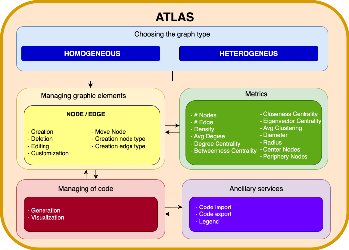
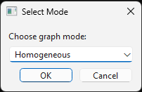
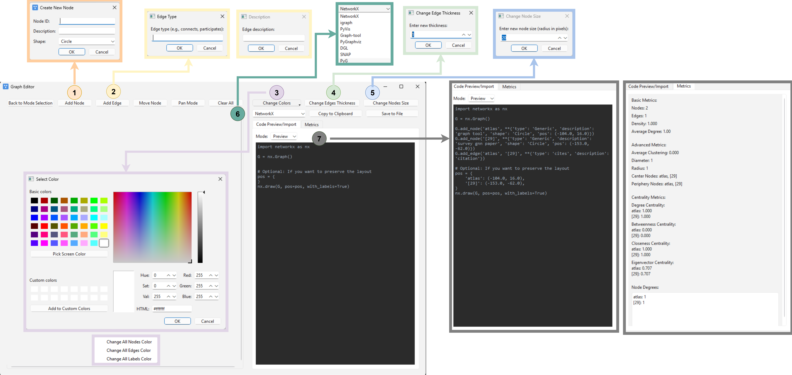
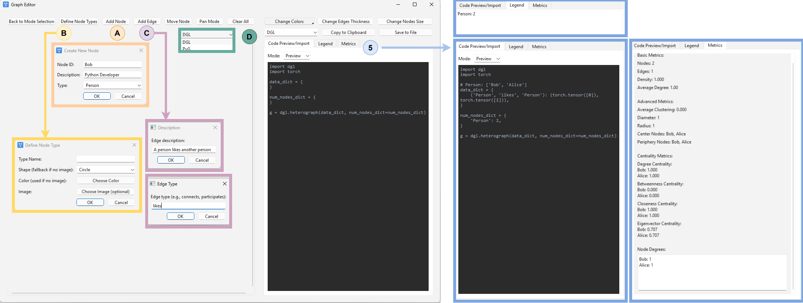
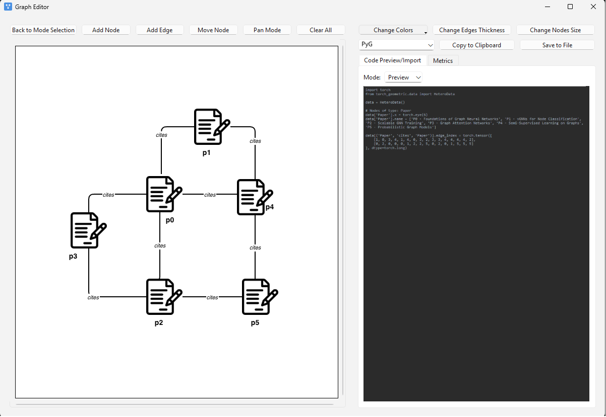
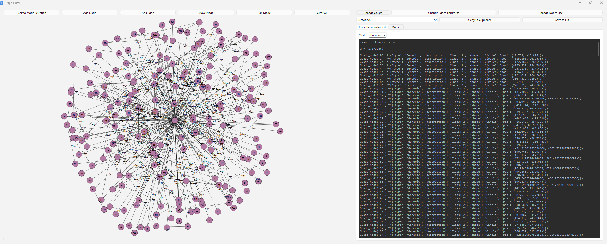
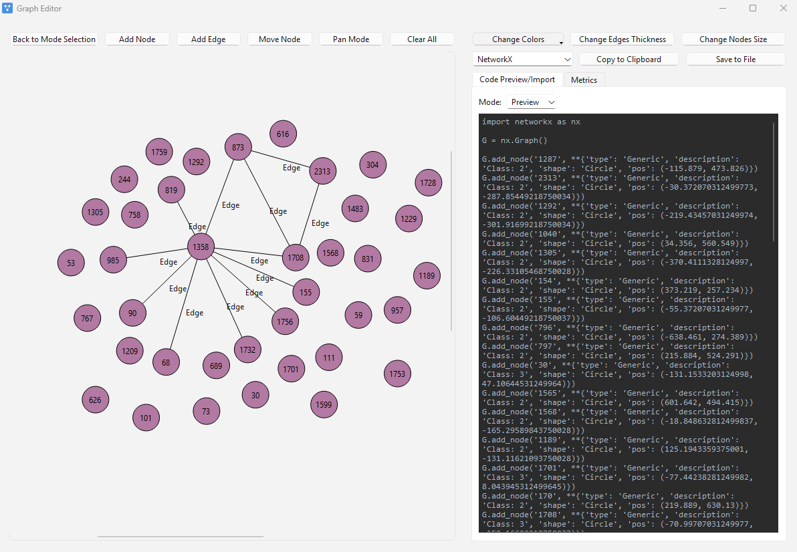
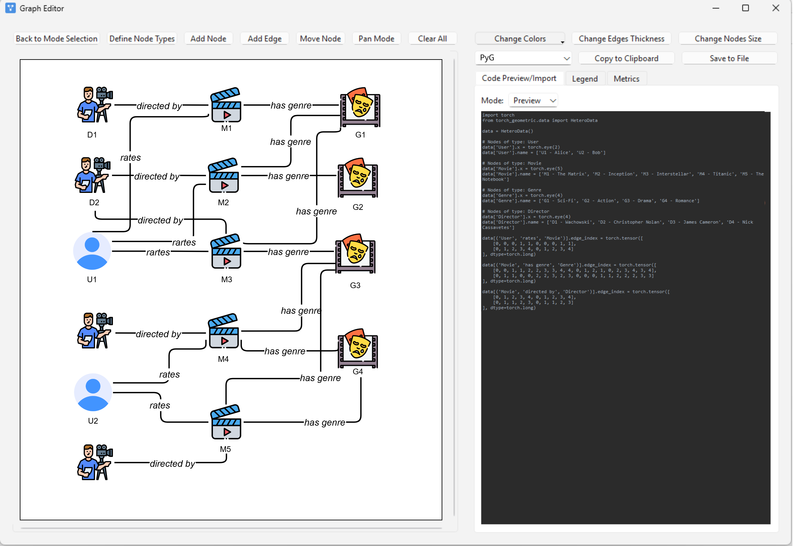
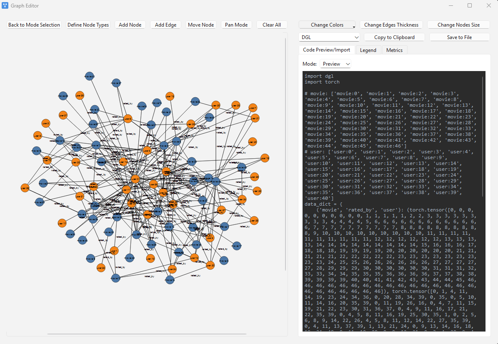
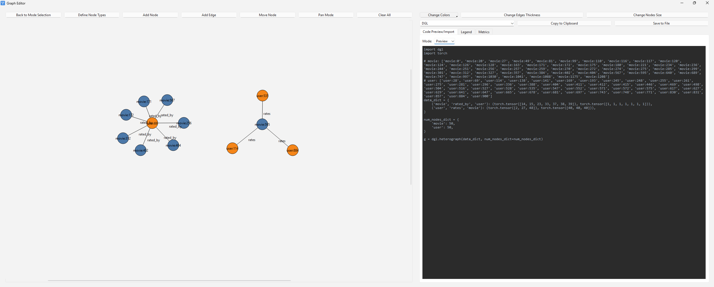

# <p align="center">ATLAS</p>
<h3 align="center">A Software for Interactive Modeling and Analysis of Homogeneous and Heterogeneous Graphs</h3>

<p align="center">
  <a href="docs/manuscript.pdf"></a>
  <a href="https://doi.org/10.1016/j.neucom.2026.135318"></a>
  <a href="https://www.python.org/downloads/release/python-3120/"></a>
  <a href="https://riverbankcomputing.com/software/pyqt/"></a>
  <a href="https://github.com/astral-sh/uv"></a>
  <a href="LICENSE"></a>
</p>

<p align="center">
  
</p>

<p align="center">
  <a href="#manuscript"><b>📄 Manuscript</b></a> •
  <a href="#features"><b>✨ Features</b></a> •
  <a href="#backends"><b>🔄 Backends</b></a> •
  <a href="#setup"><b>⚡ Setup</b></a> •
  <a href="#launch"><b>🚀 Launch</b></a> •
  <a href="#interface"><b>🖥️ Interface</b></a> •
  <a href="#case-studies"><b>🔬 Case Studies</b></a> •
  <a href="#citation"><b>📖 Citation</b></a>
</p>

---

<a id="manuscript"></a>
> [!IMPORTANT]
> ### 📄 Published Article & Manuscript
> This repository contains the official implementation of **ATLAS**, presented in:
> 
> **"ATLAS: A Software for Interactive Modeling and Analysis of Homogeneous and Heterogeneous Graphs"**  
> *Gianluca Zaza, Raffaele Scaringi, Gianluca Conserva, Davide Leone, and Gabriella Casalino*  
> **Neurocomputing**, Volume 709, Article 135318, 2026.  
> 🔗 **DOI**: [10.1016/j.neucom.2026.135318](https://doi.org/10.1016/j.neucom.2026.135318)  
> 
> 📥 **Full Manuscript PDF**: You can view and download the complete manuscript directly within this repository at [**`docs/manuscript.pdf`**](docs/manuscript.pdf).

---

<a id="overview"></a>
## 📌 Overview

**ATLAS** is a general-purpose, interactive software framework designed to bridge visual graph modeling with modern programmatic graph analytics and Graph Neural Network (GNN) workflows.

Implemented in Python (PyQt6), ATLAS enables users to:
- **Design visually**: Construct and customize both homogeneous and heterogeneous graphs interactively with drag-and-drop mechanics.
- **Inspect in real time**: Compute and monitor structural graph properties and topological indicators on the fly.
- **Generate executable code**: Export visual graph representations directly into production-ready Python code for major graph libraries: **NetworkX**, **igraph**, **PyVis**, **DGL**, and **PyTorch Geometric (PyG)**.
- **Bidirectional workflow**: Import existing Python graph definitions to reconstruct and interactively edit graphs on canvas.
- **Explainable AI (XAI)**: Visualize and inspect graph-based explanations generated by GNN models (such as *GNNExplainer*) to interpret graph learning predictions.

---

<a id="features"></a>
## ✨ Features

- **Interactive Graph Construction**:
  - Support for both **homogeneous** (single entity/relation type) and **heterogeneous** (multi-entity/multi-relation with custom types and icons) graphs.
  - Interactive canvas with smooth pan, zoom, and drag-and-drop node placement.
- **Visual Customization**:
  - Fine-grained styling of nodes (color, shape, size, border, custom icon images) and edges (color, line style, width, directionality, relational labels).
  - Built-in type management and semantic legends for heterogeneous domains.
- **Structural Real-Time Analytics**:
  - Instantaneous metrics computation: node count, edge count, density, average degree, connected components, and degree distributions.
- **Automated Code Generation & Synchronization**:
  - Synchronous generation of clean, executable Python scripts as you model on the canvas.
  - One-click copy or standalone `.py` script export.
- **Bidirectional Python Import**:
  - Import external Python scripts containing graph definitions directly into the canvas.
- **GNN & XAI Pipeline Integration**:
  - Direct visualization of benchmark datasets (e.g., Cora, MovieLens).
  - Visualization of subgraph explanations generated by GNN explanation algorithms.

---

<a id="backends"></a>
## 🔄 Supported Backends

ATLAS provides multi-framework code generation and import capabilities:

| Backend Framework | Graph Type | Code Export | Code Import | Typical Use Case |
| :--- | :---: | :---: | :---: | :--- |
| **NetworkX** | Homogeneous | ✅ | ✅ | Algorithmic exploration & structural analysis |
| **PyTorch Geometric (PyG)** | Homogeneous & Heterogeneous (`HeteroData`) | ✅ | ✅ | Deep learning pipelines & GNN training |
| **DGL** | Homogeneous & Heterogeneous | ✅ | — | High-performance graph neural network models |
| **igraph** | Homogeneous | ✅ | — | High-speed algorithmic routines & large graph metrics |
| **PyVis** | Homogeneous | ✅ | — | Interactive, web-based physics/browser visualizations |

---

<a id="setup"></a>
## ⚡ Environment Setup

ATLAS targets **Python 3.12+** and uses [**`uv`**](https://github.com/astral-sh/uv) for fast, reliable, and reproducible dependency management.

### 1. Install `uv` (if not already installed)
```bash
# Linux / macOS
curl -LsSf https://astral.sh/uv/install.sh | sh

# Windows (PowerShell)
powershell -ExecutionPolicy ByPass -c "irm https://astral.sh/uv/install.ps1 | iex"
```

### 2. Clone the Repository
```bash
git clone https://github.com/cilabuniba/atlas.git
cd atlas
```

### 3. Sync Dependencies
Install all required dependencies within a virtual environment automatically managed by `uv`:
```bash
uv sync
```

### Dependency Breakdown

The project dependencies are grouped into two complementary categories:

<details>
<summary><b>🎨 GUI & Graph Visualization Dependencies</b></summary>

| Package | Purpose |
| :--- | :--- |
| `pyqt6` | Modern Qt6 graphical user interface framework |
| `networkx` | Core graph representation and topological metrics calculation |
| `scipy` | Scientific computing utilities and sparse matrix operations |
| `pandas` | Tabular data manipulation and metric formatting |
| `ruamel-yaml` | Safe, round-trip YAML configuration parsing |
| `click` | Command-line interface utilities |
| `jupyter` | Interactive notebooks for benchmarking and evaluation |

</details>

<details>
<summary><b>🧠 GNN Training & Explanation Dependencies</b></summary>

| Package | Purpose |
| :--- | :--- |
| `torch` | Core deep learning framework for GNN training |
| `torch-geometric` | Graph deep learning library (models, datasets, explainers) |
| `torchmetrics` | Machine learning evaluation metrics |
| `transformers` | Multimodal and transformer-based components |

</details>

> [!TIP]
> If you only wish to use the graphical interface for visual graph editing and code generation, the visualization dependencies are sufficient. Running the case-study experiments, training GNN models, or generating GNNExplainer scripts utilizes the full environment.

---

<a id="launch"></a>
## 🚀 Launching ATLAS

Launch the ATLAS desktop application using `uv`:

```bash
uv run main.py
```

Upon startup, ATLAS prompts you to choose the graph modeling paradigm:

<p align="center">
  
</p>

- **Homogeneous Graphs**: All nodes and edges share identical semantic categories (e.g., citation networks, simple social graphs).
- **Heterogeneous Graphs**: Multiple entity types and relation categories coexist (e.g., knowledge graphs, recommendation systems).

---

<a id="interface"></a>
## 🖥️ Software Description

### 1. Homogeneous Graphs

<p align="center">
  
</p>

The homogeneous editor provides a streamlined workspace for building and analyzing single-type networks:

- **Node Creation & Customization**: Add nodes via **Add Node** with custom IDs, textual labels, shapes, dimensions, and colors. Nodes can be freely dragged across the infinite canvas.
- **Edge Creation**: Connect nodes via **Add Edge**, defining directional orientation, relational labels, and descriptions.
- **Visual Styling**: Customize canvas background, node palettes, border thickness, font sizes, and layout styles in real time.
- **Real-Time Graph Metrics**: The sidebar continuously recalculates structural indicators (nodes, edges, density, average degree) as you add or delete elements.
- **Synchronized Code Preview**: Inspect executable Python code generated dynamically for NetworkX, igraph, PyVis, DGL, or PyTorch Geometric.

---

### 2. Heterogeneous Graphs

<p align="center">
  
</p>

The heterogeneous mode allows representing complex multi-relational domains:

- **Node Type Management**: Define semantic categories (e.g., *User*, *Movie*, *Director*), each assigned a custom color, geometry, and optional custom image icon.
- **Typed Relations**: Connect nodes using canonical relation triplets `(source_type, relation_type, destination_type)`.
- **Integrated Semantic Legend**: A persistent legend tracks node types, icons, and counts.
- **Advanced Code Generation**:
  - **PyTorch Geometric**: Exports directly to a structured `HeteroData` object with grouped edge indices and feature tensor placeholders.
  - **DGL**: Exports heterogeneous graphs using canonical edge type dictionaries.
- **Code Import**: Load existing `HeteroData` definitions to instantly visualize complex multi-partite graph topologies.

---

<a id="case-studies"></a>
## 🔬 Case Studies

ATLAS comes with end-to-end reproducible case studies demonstrating its integration with deep learning workflows and Explainable AI (XAI).

```
                      ┌────────────────────────┐
                      │ 1. Train GNN Model     │
                      └───────────┬────────────┘
                                  ▼
                      ┌────────────────────────┐
                      │ 2. Compute Explanation │ (GNNExplainer)
                      └───────────┬────────────┘
                                  ▼
                      ┌────────────────────────┐
                      │ 3. Export Code Script  │
                      └───────────┬────────────┘
                                  ▼
                      ┌────────────────────────┐
                      │ 4. Visual Analysis     │ (ATLAS Canvas)
                      └────────────────────────┘
```

---

### 📘 Case Study 1: Cora Citation Network (Homogeneous)

The **Cora** dataset is a benchmark citation network consisting of scientific publications (nodes) linked by citation relationships (directed edges).

#### 1. Interactive Construction
Build representative citation subgraphs directly within ATLAS:

<p align="center">
  
</p>

#### 2. Full Dataset Visualization
Generate the Python reconstruction code for the complete Cora network and import it into ATLAS:

```bash
uv run script_exe.py dataset_code \
    --parameters configs/dataset_download/planetoid.yaml
```
Import the generated file `dataset_code/planetoid/graph_export.py` into ATLAS:

<p align="center">
  
</p>

#### 3. GNN Training & Explanation Visualization
Train a Graph Attention Network (GAT), compute explanations via **GNNExplainer**, and visualize the explanatory subgraph:

```bash
# Step 1: Train the GNN model
uv run script_exe.py training \
    --parameters configs/training/planetoid.yaml \
    --cls PlanetoidRun

# Step 2: Generate GNNExplainer explanations
uv run script_exe.py explain \
    --parameters configs/explain/planetoid.yaml \
    --cls PlanetoidExplainerRun

# Step 3: Export explanation visualization code
uv run script_exe.py dataset_code \
    --parameters configs/explanation_code/planetoid.yaml \
    --explanation
```

Import `dataset_code/planetoid/explanation_export.py` into ATLAS to visually inspect the influential neighborhood and citation structure supporting the model's prediction:

<p align="center">
  
</p>

---

### 🎬 Case Study 2: MovieLens Recommendation System (Heterogeneous)

The **MovieLens** dataset represents a multi-relational recommender ecosystem containing four node types (*User*, *Movie*, *Director*, *Genre*) connected via typed relations:
- `rates`: User $\rightarrow$ Movie
- `directed_by`: Movie $\rightarrow$ Director
- `has_genre`: Movie $\rightarrow$ Genre

#### 1. Interactive Modeling with Custom Icons
Assign custom icons to represent entities visually (camera for directors, person for users, clapperboard for movies, theatre-mask for genres):

<p align="center">
  
</p>

#### 2. Full Dataset Visualization
Generate the heterogeneous export script for MovieLens:

```bash
uv run script_exe.py dataset_code \
    --parameters configs/dataset_download/movielens.yaml \
    --hetero
```

Import `dataset_code/movielens/graph_export.py` into ATLAS:

<p align="center">
  
</p>

#### 3. Heterogeneous GNN Training & Link Prediction Explanation
Train a heterogeneous GNN for link prediction and extract explanations identifying the key multi-relational paths influencing recommendations:

```bash
# Step 1: Train the heterogeneous GNN
uv run script_exe.py training \
    --parameters configs/training/movielens.yaml \
    --cls MovielensRun

# Step 2: Compute link prediction explanations
uv run script_exe.py explain \
    --parameters configs/explain/movielens.yaml \
    --cls MovielensExplainerRun

# Step 3: Export explanation visualization script
uv run script_exe.py dataset_code \
    --parameters configs/explanation_code/movielens.yaml \
    --explanation \
    --hetero
```

Import `dataset_code/movielens/explanation_export.py` into ATLAS:

<p align="center">
  
</p>

---

<a id="citation"></a>
## 📖 Citation

If you use **ATLAS** in your research, please cite our article:

```bibtex
@article{zaza2026atlas,
  title     = {ATLAS: A Software for Interactive Modeling and Analysis of Homogeneous and Heterogeneous Graphs},
  author    = {Zaza, Gianluca and Scaringi, Raffaele and Conserva, Gianluca and Leone, Davide and Casalino, Gabriella},
  journal   = {Neurocomputing},
  volume    = {709},
  pages     = {135318},
  year      = {2026},
  doi       = {10.1016/j.neucom.2026.135318},
  publisher = {Elsevier}
}
```

The full manuscript is available directly in this repository: [📄 **`docs/manuscript.pdf`**](docs/manuscript.pdf).

---

## 📄 License

- **Source Code**: Distributed under the [**Apache License 2.0**](LICENSE).
- **Manuscript**: Distributed under the [**Creative Commons Attribution-NonCommercial-NoDerivatives 4.0 International (CC-BY-NC-ND 4.0)**](https://creativecommons.org/licenses/by-nc-nd/4.0/) license.
